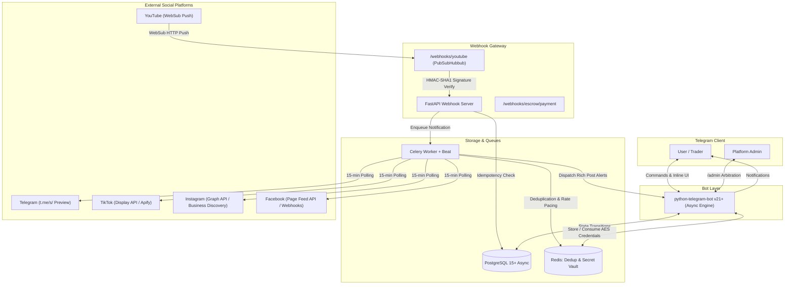
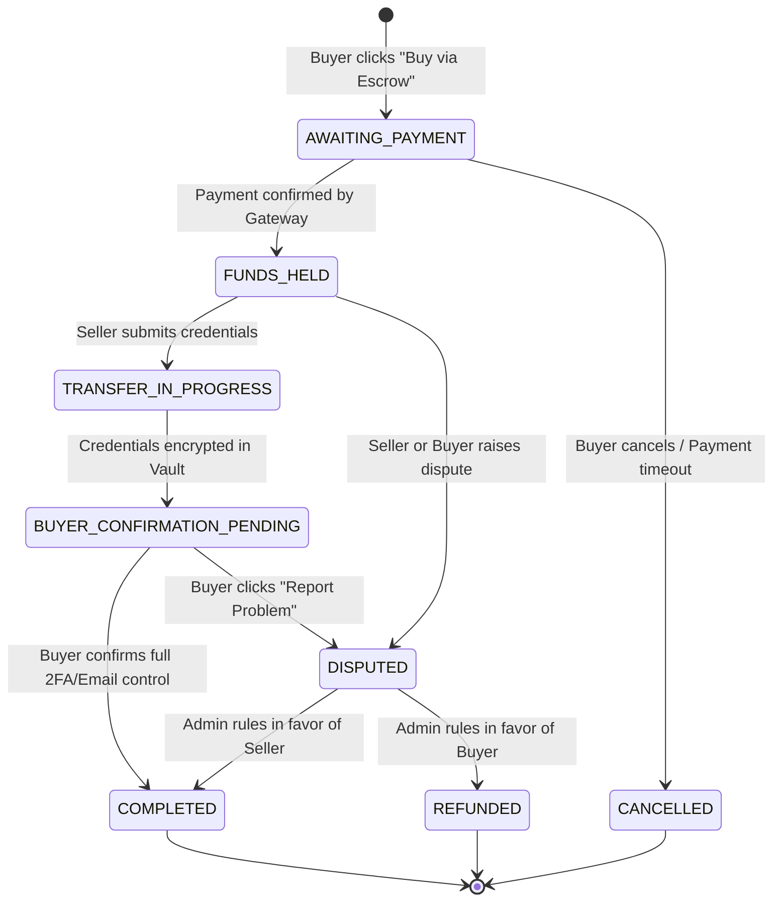

# Dual-Engine Telegram Bot: Creator Alerts & Verified Account Trading

A production-grade Telegram bot built with **Python 3.11+**, **python-telegram-bot v21+**, **FastAPI**, **PostgreSQL (SQLAlchemy 2.0 Async)**, and **Celery + Redis**.

It provides two core capabilities:
1. **Real-Time Creator Alert Engine:** Instant notifications when creators publish on **YouTube**, **Telegram** (public channels), **TikTok**, **Instagram**, and **Facebook**.
2. **Verified Account Marketplace & Escrow Engine:** A trust-first marketplace where social media accounts can be bought and sold. Sellers must pass a non-forgeable **ownership verification challenge** before listings become active, and all payments are held in an **automated escrow state machine** with credential encryption and cooling-off protection.

---

## 🏗️ System Architecture



---

## ⚖️ Platform Compliance & Terms of Service (ToS) Disclaimers

> [!IMPORTANT]
> **Zero Scraping Violations:** This project strictly avoids unauthenticated HTML scraping that violates platform terms of service or circumvents CAPTCHA bot walls.

| Platform | Ingestion Strategy | Compliance & Legal Limitations |
| :--- | :--- | :--- |
| **YouTube** | **Push (WebSub / PubSubHubbub)** | Fully compliant with Google & YouTube Data API v3 Terms. YouTube pushes XML feeds directly to your webhook. HMAC-SHA1 signature verification guarantees payload authenticity. |
| **Telegram** | **Official Web Preview (`https://t.me/s/`)** | Telegram provides public channel web previews intended for public reading without authentication. Optional Telethon userbot mode is available for private channels with authorized user credentials. |
| **TikTok** | **TikTok Display API / Apify Partner** | TikTok does not provide public webhooks for arbitrary creator profiles. Direct unauthenticated scraping triggers security challenges and violates TikTok ToS. This project implements polling via official Display API or compliant Apify actors. |
| **Instagram** | **Graph API & Business Discovery** | Meta strictly forbids scraping Instagram HTML. Real-time webhooks require app authorization by the creator. For arbitrary public creators, we use Meta Graph API **Business Discovery** (requires connected Instagram Professional/Business account). |
| **Facebook** | **Graph API Page Feed & Webhooks** | Managed Pages receive real-time webhooks for `feed`. Unmanaged public Pages are periodically polled via Graph API using a valid Page/User access token. |

---

## 🔐 Marketplace Ownership Verification & Escrow State Machine

### 1. Ownership Verification Workflow
To prevent spoofing and fraudulent listings:
1. Seller sends `/sell` and provides handle, price, followers, and niche.
2. Bot generates a unique, cryptographically random challenge code (e.g. `VERIFY-7X9K2A`).
3. Seller must temporarily place the challenge code on the account:
   - **TikTok:** In bio, or temporary video caption.
   - **YouTube:** In channel description or community post.
   - **Instagram / Facebook:** In bio / about section.
   - **Telegram Channel:** In channel description, or by adding the bot as temporary administrator with message posting permissions.
4. The verification worker scans the target profile. Once verified:
   - Listings `< $500` immediately transition to `ACTIVE`.
   - High-value listings (`>= $500`) require secondary live dashboard review (settings screen recording showing masked recovery email/phone).

### 2. Escrow State Machine Diagram



### 3. Escrow Security Rules
- **Encrypted One-Time Credential Delivery:** Credentials are encrypted using Fernet (AES-256) and delivered via a self-destructing token. Telegram's `protect_content=True` prevents forwarding and screenshotting.
- **Mandatory Buyer Transfer Checklist:**
  1. Log into account with provided credentials.
  2. Change primary recovery email & verify access.
  3. Change phone number.
  4. Change account password.
  5. Enable 2-Factor Authentication (Authenticator app).
  6. Terminate all active sessions in account security settings.
- **Cooling-Off Period:** For deals $\ge \$500$, a 7-day cooling-off timer is enforced before seller payout to prevent recovery scams.
- **Inspection Deadline:** Buyers have 48 hours to inspect and dispute; if no dispute is raised, funds auto-release.

---

## 🚀 Quick Start (Docker Compose)

### Prerequisites
- Docker Engine 24+ & Docker Compose v2+
- A Telegram Bot Token from [@BotFather](https://t.me/botfather)

### 1. Clone & Configure Environment
```bash
cp .env.example .env
```
Edit `.env` and fill in your keys:
```env
TELEGRAM_BOT_TOKEN="123456789:ABCdefGhIJKlmNoPQRsTUVwxyZ"
ADMIN_USER_IDS=[123456789]
SECRET_KEY="your-random-32-byte-hex-string"
ENCRYPTION_KEY="k_8V9QZ4l2pXvF6W3d8s9A1c4E7h0J2m"
```

### 2. Launch All Services
```bash
docker compose up -d --build
```
This starts:
- `dual_engine_postgres` on port `5432`
- `dual_engine_redis` on port `6379`
- `dual_engine_webhooks` on port `8000`
- `dual_engine_bot` (Telegram Bot polling engine)
- `dual_engine_celery_worker` (Background poller & verifier)
- `dual_engine_celery_beat` (15-min periodic scheduler)

### 3. Seed Demo Data (Optional)
To seed sample verified accounts, creators, and users:
```bash
docker compose exec bot python scripts/seed_demo.py
```

### 4. Run Test Suite
```bash
docker compose exec bot pytest -v
```

---

## 🔑 API Key Acquisition Guide

### 1. Telegram Bot Token
1. Open Telegram and search for [@BotFather](https://t.me/botfather).
2. Send `/newbot`, name your bot, and copy the HTTP API Token.
3. Find your personal Telegram ID via [@userinfobot](https://t.me/userinfobot) and set `ADMIN_USER_IDS=[your_id]`.

### 2. YouTube Data API v3 & PubSubHubbub
1. Navigate to the [Google Cloud Console](https://console.cloud.google.com/).
2. Create a project and enable the **YouTube Data API v3**.
3. Generate an API Key under **APIs & Services -> Credentials** -> set `YOUTUBE_API_KEY`.
4. Ensure your server domain has SSL (e.g. `https://yourdomain.com`) and points to `/webhooks/youtube`.

### 3. Meta Graph API (Instagram & Facebook)
1. Register at [Meta for Developers](https://developers.facebook.com/).
2. Create an App of type **Business**.
3. Add **Instagram Graph API** and **Facebook Login for Business**.
4. Generate a long-lived Access Token with `instagram_basic`, `pages_show_list`, and `instagram_manage_insights` permissions -> set `INSTAGRAM_ACCESS_TOKEN` and `FACEBOOK_ACCESS_TOKEN`.

### 4. TikTok / Apify
1. For TikTok Display API: apply at [TikTok for Developers](https://developers.tiktok.com/).
2. For public profile monitoring: register at [Apify](https://apify.com/), get your API token from **Settings -> Integrations** -> set `APIFY_API_TOKEN`.

---

## 📋 Bot Commands Reference

| Command | Description |
| :--- | :--- |
| `/start` | Dual-engine home menu with quick navigation buttons. |
| `/subscribe` | Subscribe to a creator on YouTube, TikTok, Instagram, Facebook, or Telegram. |
| `/my_subscriptions` | View active subscriptions and unsubscribe. |
| `/market` | Browse ownership-verified account listings with platform/price filters. |
| `/sell` | Guided wizard to list an account and receive verification instructions. |
| `/my_listings` | View status of your listings (Pending Verification, Active, Sold). |
| `/escrow` | Track active escrow transactions, submit/view credentials, confirm deals, or file disputes. |
| `/help` | Detailed security policy, ToS limitations, and escrow FAQ. |
| `/admin` | Admin dashboard: arbitrate disputes, review verifications, view stats, and trigger polls. |

---

## 🛡️ License & Compliance
This software is provided for compliant social media notification management and secure digital asset escrow. Users are responsible for complying with the respective Terms of Service of each integrated platform. Direct scraping of platforms that prohibit automated data collection is strictly disabled by design.

